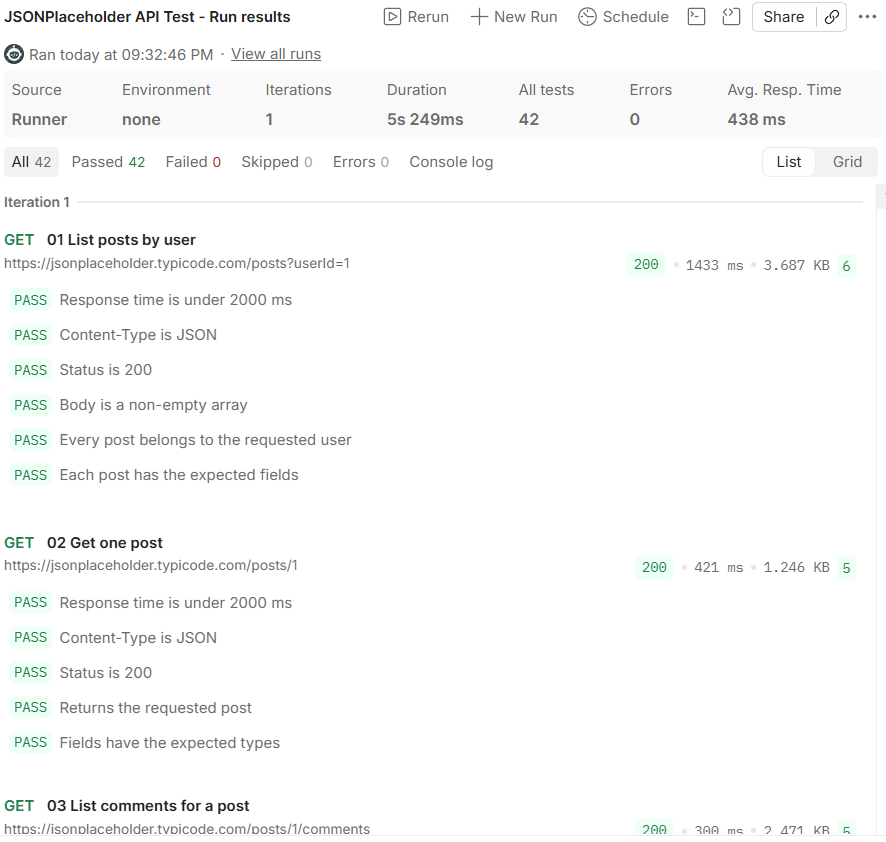

# API Testing in Postman: JSONPlaceholder

A portfolio sample showing how I test a REST API with Postman and use the results to ground technical documentation.

**API under test:** [JSONPlaceholder](https://jsonplaceholder.typicode.com), a free public REST API for testing and prototyping. It needs no API key.

> JSONPlaceholder **simulates** create, update and delete requests. It returns realistic responses but does not save any data, so a created post cannot be fetched afterwards. The tests are written with this in mind.

## What the collection covers

The collection `JSONPlaceholder-API-Test.postman_collection.json` contains 9 requests with automated checks. Each run makes 42 assertions: 24 specific to individual requests, plus 2 collection-level checks (response time and content type) that run on every request.

| # | Request | Purpose | Key checks |
|---|---|---|---|
| 01 | `GET /posts?userId=1` | Filtering and list shape | 200, non-empty array, every post belongs to the user, all four fields present |
| 02 | `GET /posts/1` | Retrieve one resource | 200, correct `id`, field types (number, string) |
| 03 | `GET /posts/1/comments` | Nested resource | 200, every comment has the right `postId`, valid-looking email |
| 04 | `POST /posts` | Create | 201, response echoes submitted data, numeric `id` returned |
| 05 | `PUT /posts/1` | Replace | 200, response contains replacement data |
| 06 | `PATCH /posts/1` | Partial update | 200, title changed, unsent fields still present |
| 07 | `DELETE /posts/1` | Delete | 200, empty object body |
| 08 | `GET /posts/9999` | Error case | 404, empty object body |
| 09 | `GET /posts?userId=9999` | Edge case | 200 with an empty array, not an error |

**Collection-level checks (every request):** response time under 2000 ms, and a JSON `Content-Type` header.

**Variables:** `baseUrl`, `postId` and `userId` are collection variables, so the same tests can be pointed at another environment or another record without editing any request.

## How to run it

### In Postman

1. Open Postman and click **Import**, then select `JSONPlaceholder-API-Test.postman_collection.json`.
2. Right-click the collection, choose **Run collection**, and click **Run JSONPlaceholder API Test**.
3. Review the pass and fail results for each request.

### From the command line (Newman)

```bash
npx newman run JSONPlaceholder-API-Test.postman_collection.json
```

## Results


| Item | Result |
|---|---|
| Run date | [13 November 2026] |
| Tool and version | [Postman (web app), Collection Runner ] |
| Requests executed | [9 of 9] |
| Assertions passed | [42 of 42] |
| Average response time | [536 ms] |
| Failures or surprises | None. The first request was the slowest at about 1.9 seconds, close to the 2000 ms limit, so response-time checks against a public API can occasionally fail on slow runs. |

## Example requests used in documentation

Postman's **Code** button exports any request as cURL, Python and other languages. These are the exported forms of requests 02 and 04.

**Get one post**

```bash
curl https://jsonplaceholder.typicode.com/posts/1
```

```python
import requests

response = requests.get("https://jsonplaceholder.typicode.com/posts/1", timeout=10)
response.raise_for_status()
print(response.json())
```

**Create a post**

```bash
curl -X POST https://jsonplaceholder.typicode.com/posts \
  -H "Content-Type: application/json" \
  -d '{"title": "Postman portfolio test", "body": "Created by an automated Postman test.", "userId": 1}'
```

```python
import requests

response = requests.post(
    "https://jsonplaceholder.typicode.com/posts",
    json={"title": "Postman portfolio test", "body": "Created by an automated Postman test.", "userId": 1},
    timeout=10,
)
print(response.status_code)  # 201
print(response.json())
```

## Why this matters for documentation

- **Examples are verified.** Every request and response shown in documentation should come from a call that was actually made.
- **Error behaviour is documented from evidence.** The 404 and empty-list cases show what a developer will really receive.
- **Limits are stated.** Because writes are simulated, any documentation based on this API has to say so.

## What I would add when testing a production API

- Authentication tests: missing, invalid and expired credentials
- Response validation against the OpenAPI schema
- Pagination, rate limiting and retry behaviour
- Request-chaining flows, such as create, then retrieve, then delete
- Separate environments (test and live) with secrets stored outside the collection

## Files

| File | Description |
|---|---|
| `JSONPlaceholder-API-Test.postman_collection.json` | Importable Postman collection with tests |
| `README.md` | This write-up |
